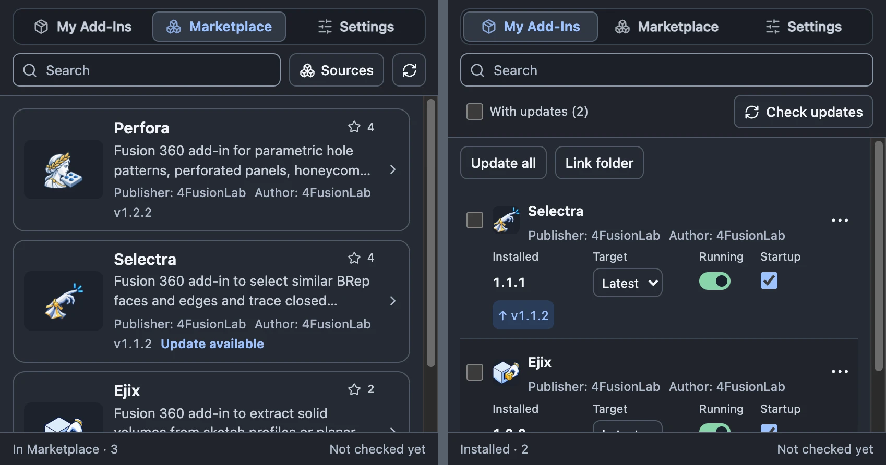

# Community Store for Autodesk Fusion

Find add-ins on GitHub Releases, choose which version to run, and manage startup from the Design workspace.

[Русская версия](README.ru.md) · [Product website](https://4fusionlab.github.io/CommunityStore/) · [Download release](https://github.com/4FusionLab/CommunityStore/releases/latest) · [Publisher guide](docs/PUBLISHER_GUIDE.md) · [Report an issue](https://github.com/4FusionLab/CommunityStore/issues)



## Using the palette

- **Find an add-in.** Open **Marketplace → Sources** to add a GitHub user or organization. Pasting a repository URL connects all eligible add-ins from its owner. Marketplace lists published releases and sorts add-ins by star count. A fresh installation starts with 4FusionLab if the source list is unavailable. [Default sources](trusted-stores.json)
- **Install a release.** Open a card to read the description and release notes. If the publisher provides several ZIPs, the picker marks the packages eligible for your platform. Store installs stable releases and checks the SHA‑256 digest, version, and add-in ID when known. You can open a prerelease on GitHub.
- **Manage installed add-ins.** **My Add-Ins** shows a row for each Fusion registration. Link a folder, run an add-in, enable startup, or choose a target version. The update preview shows which packages will change and which will be skipped. Store checks releases when Fusion starts and every 30 minutes by default, even with the palette closed. Change the interval in **Settings**.

## Installation

**Platform status.** The manifest declares macOS and Windows support. On macOS, Fusion 2706.1.17 restarted the 1.0.0 add-in and opened the installed add-ins list. Native Fusion validation on Windows x64 remains open. [Windows test guide](docs/acceptance/WINDOWS_COMMUNITY.md)

| Platform | Installer | How to install |
| --- | --- | --- |
| Windows x64 | [Download EXE](https://github.com/4FusionLab/CommunityStore/releases/download/v1.0.0/CommunityStore-Windows-Setup.exe) | Run **CommunityStore-Windows-Setup.exe**. |
| macOS | [Download DMG](https://github.com/4FusionLab/CommunityStore/releases/download/v1.0.0/CommunityStore-macOS.dmg) | Open the disk image and run **Install Community Store**. |

### Manual ZIP installation

1. Download `CommunityStore-1.0.0.zip` from **Assets** in the [1.0.0 GitHub release](https://github.com/4FusionLab/CommunityStore/releases/tag/v1.0.0) and extract it to a permanent folder. The `CommunityStore` folder should contain `CommunityStore.py` and `CommunityStore.manifest`.
2. In Fusion, open **Utilities → Add-Ins → Scripts and Add-Ins**, add the folder, and select **Run**. The supplied manifest enables **Run on Startup**.
3. Open **Community Store** from the **Add-Ins** panel in the Design workspace.

You can skip the first-run guide or restart it from **Settings → Reset tutorial**. A GitHub account is optional. Public browsing, installing ZIPs and managing local add-ins work signed out. Signing in uses your authenticated GitHub request quota.

## Publish your add-in

Publish a release in a public GitHub repository and attach the installable ZIP. Users can then connect your GitHub profile or organization in **Sources**. The guide covers repository discovery, ZIP layout, manifests, and the README shown on your catalog page. To request inclusion in the default catalog, submit your profile and an example release for review. [Publisher guide](docs/PUBLISHER_GUIDE.md) · [Submit a source](https://github.com/4FusionLab/CommunityStore/issues/new?template=request-source.yml)

## Files, archives, and recovery

Removing a local add-in moves its folder into the adjacent `.community-store-removed` directory. Store unregisters linked repositories and hides externally managed installations in Fusion. In both cases the files stay in place.

Store installs packages in `CommunityStore/AddIns`. An update to a Store-managed package keeps its previous folder, including files you added, in `.community-store-backups` beside that package. When an eligible linked folder is migrated to Store management, its original files stay in place. Check the update preview before applying changes.

After archiving an add-in, open **My Add-Ins → Restore from archive → Open archive**. Copy the saved folder to a permanent location, give it the same name as its manifest without the extension and choose **Link folder**. The archive remains accessible after restarting Store.

### Recover an interrupted update

If Fusion exits during a managed add-in update and the add-in is missing or fails to start, close Fusion. In the add-in's parent directory, locate the copy in `.community-store-backups` and verify its name, ID and version in its manifest. Keep any partially installed folder by moving it to a separate location. Copy the verified backup to the original path using the folder name that matches the manifest. Reopen Fusion. If the registration is missing, use the folder button in **My Add-ins** to register the restored folder. Check the installed version, running state and **Run on Startup** before updating again.

## Build from source

```bash
python3 scripts/check_project.py
python3 -m unittest discover -s tests -v
python3 scripts/build.py --version 1.0.0
```

The build writes a ZIP and a SHA‑256 file to `dist/`.

[Development](docs/DEVELOPMENT.md) · [PolyForm Noncommercial License 1.0.0](LICENSE)

The palette design was refined with [Unslop](https://heydamir.design/unslop) by Damir Sokolovsky.
