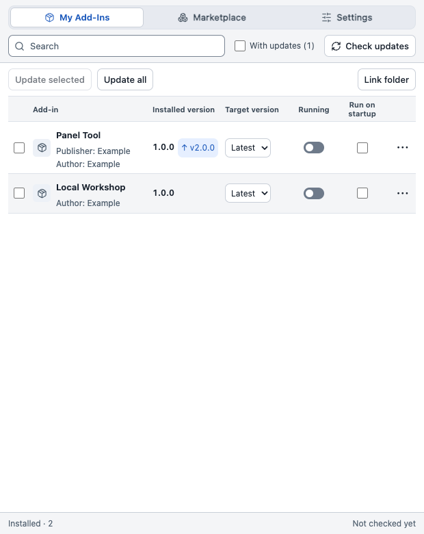

# Community Store for Autodesk Fusion

[Русская версия](README.ru.md) · [Download release](https://github.com/4FusionLab/CommunityStore/releases/latest) · [Report an issue](https://github.com/4FusionLab/CommunityStore/issues)

Manage installed add-ins in Fusion and install published packages from GitHub Releases. Community Store uses existing Fusion manifests and release packages.

[Publisher guide for third-party add-ins](docs/PUBLISHER_GUIDE.md)



## Installation

1. Download `CommunityStore-1.0.0.zip` from **Assets** in the [1.0.0 GitHub release](https://github.com/4FusionLab/CommunityStore/releases/tag/v1.0.0) and extract it to a permanent folder. The `CommunityStore` folder should contain `CommunityStore.py` and `CommunityStore.manifest`.
2. In Fusion, open **Utilities → Add-Ins → Scripts and Add-Ins**, add the folder, and select **Run**. The supplied manifest enables **Run on Startup**.
3. Open **Community Store** from the **Add-Ins** panel in the Design workspace.

You can skip the first-run guide or restart it from **Settings → Reset tutorial**. A GitHub account is optional. Public browsing, installing ZIPs and managing local add-ins work signed out. Signing in uses your authenticated GitHub request quota.

## Palette

- **My Add-ins** lists visible user add-ins from Fusion. Each registration has its own row, including registrations that point to the same files. The columns show installed and available versions, running status, and startup settings. Removal archives local installations in `.community-store-removed` next to the add-in directory. Linked repositories are unregistered and their files are kept. Add-ins managed by another installer are hidden in Fusion and their files are kept.
- **Marketplace** discovers public add-in repositories with published releases from connected GitHub owners. Names, descriptions, stars, tags, and ZIP options come from GitHub. Results are sorted by star count. Published prereleases can appear with a GitHub link. Installation and updates from the palette use stable releases.
- **Sources** in Marketplace shows how many add-ins are installed from each owner. A GitHub account, organization, or repository URL connects the entire owner. At startup, Store loads the [default source list](trusted-stores.json). A fresh installation starts with 4FusionLab if the list is unavailable.
- **Settings** controls the check interval. By default, Community Store checks releases when Fusion starts and every 30 minutes, including while the palette is closed.

Community Store uses the ZIP assets attached to a release. When several ZIPs are available, the palette offers a choice and marks the ones supported on the current platform. Before installing, it checks the SHA‑256 digest, version, and add-in ID when available.

Store installs packages in `CommunityStore/AddIns`. An update to a Store-managed package keeps its previous folder, including files you added, in `.community-store-backups` beside that package. When an eligible linked folder is migrated to Store management, its original files stay in place. Check the update preview before applying changes.

After archiving an add-in, open **My Add-Ins → Restore from archive → Open archive**. Copy the saved folder to a permanent location, give it the same name as its manifest without the extension and choose **Link folder**. The archive remains accessible after restarting Store.

### Recover an interrupted update

If Fusion exits during a managed add-in update and the add-in is missing or fails to start, close Fusion. In the add-in's parent directory, locate the copy in `.community-store-backups` and verify its name, ID and version in its manifest. Keep any partially installed folder by moving it to a separate location. Copy the verified backup to the original path using the folder name that matches the manifest. Reopen Fusion. If the registration is missing, use the folder button in **My Add-ins** to register the restored folder. Check the installed version, running state and **Run on Startup** before updating again.

## Build and validation

```bash
python3 scripts/check_project.py
python3 -m unittest discover -s tests -v
python3 scripts/build.py --version 1.0.0
```

The build writes a ZIP and a SHA‑256 file to `dist/`. The manifest declares macOS and Windows support. On macOS, Fusion 2706.1.17 restarted the 1.0.0 add-in and opened the palette with a populated list of installed add-ins. Native Fusion validation on Windows x64 remains open. [Windows installation, test scenarios and reporting](docs/acceptance/WINDOWS_COMMUNITY.md)

[Development](docs/DEVELOPMENT.md) · [PolyForm Noncommercial License 1.0.0](LICENSE)

The palette design was refined with [Unslop](https://heydamir.design/unslop) by Damir Sokolovsky.
