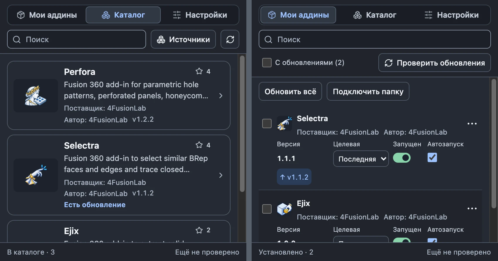

# Community Store для Autodesk Fusion

Находите аддины из GitHub Releases, выбирайте версию и управляйте запуском прямо в рабочей области Design.

[English](README.md) · [Сайт проекта](https://4fusionlab.github.io/CommunityStore/ru/) · [Скачать релиз](https://github.com/4FusionLab/CommunityStore/releases/latest) · [Руководство для авторов](docs/PUBLISHER_GUIDE.ru.md) · [Сообщить о проблеме](https://github.com/4FusionLab/CommunityStore/issues)



## Работа в палитре

- **Найти аддин.** В разделе «Каталог» откройте **Источники**, чтобы добавить пользователя или организацию GitHub. Ссылка на репозиторий подключает все подходящие аддины его владельца. Каталог показывает опубликованные релизы и сортирует аддины по числу звёзд. При первом запуске без сети доступен источник 4FusionLab. [Источники по умолчанию](trusted-stores.json)
- **Установить релиз.** Откройте карточку, прочитайте описание и примечания к выпуску. Если автор приложил несколько ZIP, палитра отмечает подходящие для вашей платформы. Store устанавливает стабильные релизы, сверяет SHA‑256, версию и ID аддина, если он известен. Предварительный релиз можно посмотреть на GitHub.
- **Управлять установленными аддинами.** В разделе «Мои аддины» каждой регистрации Fusion соответствует отдельная строка. Здесь можно подключить папку, запустить аддин, включить автозапуск и выбрать целевую версию. Перед обновлением палитра покажет, какие пакеты будут обновлены или пропущены. По умолчанию Store проверяет релизы при запуске Fusion и каждые 30 минут, даже когда палитра закрыта. Интервал можно изменить в настройках.

## Установка

**Платформы.** Манифест объявляет поддержку macOS и Windows. На macOS в Fusion 2706.1.17 проверили перезапуск аддина 1.0.0 и открытие списка установленных аддинов. Проверка в Fusion на Windows x64 остаётся открытой. [Сценарии проверки на Windows](docs/acceptance/WINDOWS_COMMUNITY.ru.md)

| Платформа | Установщик | Как запустить |
| --- | --- | --- |
| Windows x64 | [Скачать EXE](https://github.com/4FusionLab/CommunityStore/releases/download/v1.0.0/CommunityStore-Windows-Setup.exe) | Запустите **CommunityStore-Windows-Setup.exe**. |
| macOS | [Скачать DMG](https://github.com/4FusionLab/CommunityStore/releases/download/v1.0.0/CommunityStore-macOS.dmg) | Откройте образ и запустите **Install Community Store**. |

### Ручная установка из ZIP

1. Скачайте файл `CommunityStore-1.0.0.zip` из раздела **Assets** [релиза 1.0.0 на GitHub](https://github.com/4FusionLab/CommunityStore/releases/tag/v1.0.0) и распакуйте его в постоянную папку. Папка `CommunityStore` должна содержать `CommunityStore.py` и `CommunityStore.manifest`.
2. В Fusion откройте **Utilities → Add-Ins → Scripts and Add-Ins**, добавьте эту папку и нажмите **Run**. В поставляемом манифесте включён **Run on Startup**.
3. Открывайте **Community Store** на панели **Add-Ins** рабочего пространства Design.

При первом открытии обучение можно пропустить. Чтобы пройти его заново, нажмите **Settings → Reset tutorial** («Настройки → Сбросить обучение»). Просматривать публичный каталог, устанавливать ZIP и управлять локальными аддинами можно без входа. После входа запросы к GitHub используют квоту вашего аккаунта.

## Как добавить свой аддин в каталог

Опубликуйте релиз в публичном репозитории GitHub и приложите установочный ZIP. Пользователи смогут подключить ваш профиль или организацию в разделе «Источники». В руководстве разобраны обнаружение репозитория, структура ZIP, манифест и оформление карточки. Чтобы ваш источник появился в каталоге по умолчанию, отправьте ссылку на профиль и пример релиза на рассмотрение. [Руководство для авторов](docs/PUBLISHER_GUIDE.ru.md) · [Предложить источник](https://github.com/4FusionLab/CommunityStore/issues/new?template=request-source-ru.yml)

## Файлы, архив и восстановление

При удалении локального аддина Store переносит его папку в соседний каталог `.community-store-removed`. Для подключённого репозитория Store снимает регистрацию в Fusion. Для аддина под управлением другого установщика Store скрывает запись в Fusion. В обоих случаях файлы сохраняются.

Store устанавливает пакеты в `CommunityStore/AddIns`. При обновлении такого пакета его прежняя папка, включая добавленные вами файлы, сохраняется в соседнем каталоге `.community-store-backups`. Если обновление переносит подключённый из папки аддин под управление Store, файлы в исходной папке остаются на месте. Перед применением изменений проверьте список в окне обновления.

После архивирования на вкладке **Мои аддины** откройте **Восстановление из архива → Открыть архив**. Скопируйте нужную папку в постоянное место, верните ей имя манифеста без расширения и нажмите **Подключить папку**. Архив доступен и после перезапуска Store.

### Если обновление прервалось

Если Fusion закрылся во время обновления и аддин исчез из списка или перестал запускаться, закройте Fusion. Рядом с папкой аддина найдите копию в `.community-store-backups` и сверьте имя аддина, ID и версию в манифесте. Если на прежнем месте осталась частично установленная версия, переместите её в отдельную папку. Скопируйте проверенную резервную копию на прежнее место под именем, которое совпадает с именем манифеста. Откройте Fusion. Если регистрация исчезла, подключите восстановленную папку на вкладке **Мои аддины**. Перед следующим обновлением проверьте установленную версию, запуск и **Run on Startup**.

## Сборка из исходников

```bash
python3 scripts/check_project.py
python3 -m unittest discover -s tests -v
python3 scripts/build.py --version 1.0.0
```

Сборка записывает ZIP и файл SHA‑256 в `dist/`.

[Разработка](docs/DEVELOPMENT.ru.md) · [PolyForm Noncommercial License 1.0.0](LICENSE)

Оформление переработано с помощью [Unslop](https://heydamir.design/unslop) Дамира Соколовского.
